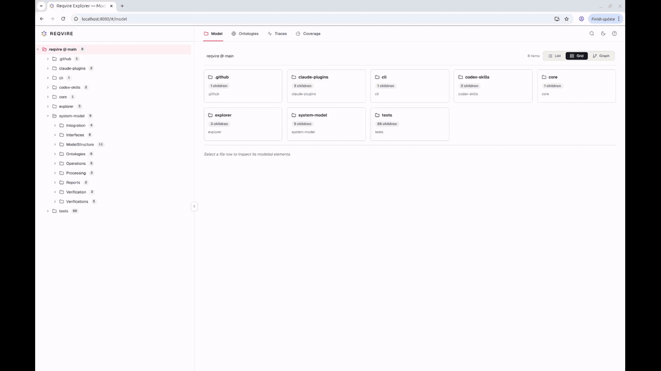

<div align="center">



[](https://github.com/reqvire-org/reqvire/releases)
[](https://opensource.org/licenses/Apache-2.0)
[](https://www.rust-lang.org/)

[📖 **Documentation**](https://www.reqvire.org) • [🔍 **Explore Reqvire**](https://reqvire-org.github.io/reqvire/) • [🚀 **Quick Start**](#quick-start) • [👥 **Contributing**](./doc/README.md)

</div>

# What is Reqvire?

A semantic engineering framework for building verifiable and traceable software.

Reqvire is a Git-native semantic engineering model for ontologies, capabilities,
requirements, contracts, verification plans, evidence, and implementation links.
It keeps engineering intent close to the codebase, computes typed change impact
across the model, and gives engineers and AI assistants scoped implementation
context constrained by requirements, contracts, and verification evidence.

Use the CLI, Explorer UI, and MCP tools to navigate from intent to code,
understand what changes affect, and keep implementation work aligned with the
verified system model.

Use Reqvire to:
- define shared ontology vocabulary and semantic contracts
- connect capabilities to implementable requirements
- attach requirement-owned contracts for behavior, state, I/O, sources, and constraints
- plan verification and link concrete evidence
- inspect traceability, coverage, and change impact
- expose structured engineering context to AI workflows without exporting a separate model

## Latest Changes

**Breaking change: model authoring now uses MCP.** Reqvire's typed MCP tools are
the supported interface for creating and editing system models. Accepted
mutations validate the candidate model and automatically persist canonical
formatting. Start `reqvire mcp --enable-mutations` to enable authoring,
formatting application, and safe lint repair.

The CLI authoring commands `add`, `rm`, `mv`, `rename`, `merge`, `mv-file`,
`mv-folder`, `link`, `unlink`, `relink`, `mv-asset`, and `rm-asset` have been
removed, including their previews. CLI `format` moves to the MCP tool
`reqvire.format`; CLI `lint --fix` moves to `reqvire.lint` with `fix: true`.
Formatting preview and lint inspection are available through MCP in read-only
mode; applying either requires mutations to be enabled.

The CLI continues to provide validation, lint inspection, discovery, coverage,
reports, exports, managed-query inspection, and server startup. Migration
remains a **CLI-only operation** so incompatible models can be upgraded before
the MCP server passes startup validation.

For older workspaces, preview supported breaking model updates with:

```bash
reqvire migrate
reqvire migrate --fix
```

`reqvire migrate` is dry-run by default; `--fix` applies deterministic migrations
such as legacy document header cleanup, verification-objective holder creation,
contract relation cleanup, and migration of legacy contract section headings to
`Contract Bindings`.

---

# Quick Start

## Install Reqvire CLI

```bash
curl -fsSL https://raw.githubusercontent.com/reqvire-org/reqvire/main/scripts/install.sh | bash
```

Validate a Reqvire workspace:

```bash
reqvire validate
```

Open the Explorer UI from an installed Reqvire binary:

```bash
reqvire serve
```

Then open the printed local URL, usually:

```text
http://localhost:8080/
```

No-install npm form:

```bash
npx -y @reqvire-org/reqvire@latest --workspace /absolute/path/to/workspace serve
```

The effective workspace root is the path used for Reqvire identifiers and
relative paths. It must contain at least one eligible Git worktree; files under
the workspace but outside Git worktrees are ignored by model processing.

### Multi-repository models

Use an initialized Google Repo workspace to combine its own model with declared
component repositories. Runtime prerequisites are
Git, Python 3 and an initialized Google Repo client. Install the `repo` launcher
and explicitly run `repo init` and `repo sync` before using Reqvire. By default,
Reqvire follows Repo's active `.repo/manifest.xml`, its manifest checkout and
local overlays, including standalone manifests. No duplicate root manifest is
needed. Use `--manifest` only to select another manifest file location; its
format, Git ownership and history stay the same. Keep `.repo/` and component
checkout directories ignored by Central Git. All declared projects must be local, inside
Central, at the selected revisions, and match their declared repository identity.
Project paths must be unique and non-overlapping. Repo submanifests are unsupported.

```bash
# From an already initialized and synced Central checkout
reqvire validate                         # default: .repo/manifest.xml
reqvire --manifest .repo/manifests/review.xml validate
reqvire --manifest .repo/manifests/review.xml serve --enable-mcp --enable-mutations
```

CLI, MCP and Explorer share the combined model and Central-relative identifiers.
Workspace `.reqvireignore` rules remain global; each repository's Git ignores
apply to its own files. A selected manifest failure is an error, and Reqvire
never fetches missing projects or revisions implicitly.

MCP's `branch` argument selects the owning worktree. Native Repo contexts keep
private manifest inputs and component checkouts. Mutations save files in their
owning repositories; component commits update the selected manifest's pins.
Repo-managed inputs retain their manifest project's Git publication workflow;
files belonging to Central are checkpointed with Central. Optional GitHub publication pushes required
component commits before Central. See the
[User Guide](https://www.reqvire.org/user-guide) and
[MCP Server guide](https://www.reqvire.org/mcp-server) for setup and recovery.

The Explorer UI is embedded in release/npm binaries. Source builds are for
development and must build the Explorer bundle before compiling Rust.

---

# Development setup

An optional Hermit environment in `bin/` pins the Rust, Node, Bun, Python,
ripgrep and Google Repo versions used for development. Activate it with
`source bin/activate-hermit`, then run `hermit install` and `make build`.
System Git, Make, a native linker and browser system libraries remain OS
prerequisites. See [Contributor setup](doc/README.md#development-quick-start)
for build, browser and multi-repository test instructions.

---

# Skills and MCP

Reqvire exposes model context through an MCP server and ships setup assets for
Claude Code and Codex. Full setup details live in the documentation:
[Coding Assistants](https://www.reqvire.org/coding-assistants)

## MCP Server

Start the MCP server with the Reqvire CLI:

```bash
reqvire --workspace /absolute/path/to/workspace mcp
```

Convenience no-install form using the npm package:

```bash
npx -y @reqvire-org/reqvire@latest --workspace /absolute/path/to/workspace mcp
```

This exposes Reqvire engineering context to AI assistants through the Model Context Protocol (MCP).

Model authoring is available through typed MCP tools only. Start the server with
`--enable-mutations` for CRUD tools and their previews, formatting application,
and safe lint repair. Successful authored-model mutations automatically persist
canonical formatting. `reqvire.format` previews and `reqvire.lint` inspection
remain available in read-only mode.

The CLI retains validation, lint inspection, coverage, discovery, reports,
exports, managed-query inspection, and server startup. `migrate` and
`migrate --fix` remain CLI operations so incompatible source can be upgraded
before validated MCP startup. CLI CRUD, `format` (including preview), and
`lint --fix` have been removed; removed invocations fail before model loading.

Reqvire MCP uses Streamable HTTP. Start the server with the command above, then point MCP clients at:

```text
http://127.0.0.1:8081/mcp
```

Example MCP client configuration:

```json
{
  "mcpServers": {
    "reqvire-myrepository": {
      "type": "http",
      "url": "http://127.0.0.1:8081/mcp"
    }
  }
}
```

Use `mcp --transport stdio` for a client that launches Reqvire locally. HTTP
remains the default; `mcp --transport http` selects it explicitly. Stdio uses
one Reqvire process for the selected project without a listening port:

```json
{
  "mcpServers": {
    "reqvire": {
      "type": "stdio",
      "command": "npx",
      "args": [
        "-y", "@reqvire-org/reqvire@latest",
        "--workspace", "/absolute/path/to/project",
        "mcp", "--transport", "stdio"
      ]
    }
  }
}
```

Client configuration syntax varies; use the client's command/args form and an
absolute workspace path when its launch directory is uncertain. Append
`--enable-mutations` when authoring is required. Mutation
startup still requires a clean, valid, exclusively owned Git worktree; commits
remain a separate `--enable-commits` opt-in. HTTP listener and access options
(`--host`, `--port`, `--allow-origin`, `--allow-host`) are rejected with stdio.
Protocol messages use stdout and diagnostics use stderr. Closing stdin ends the
server session, releases workers and locks, and preserves pending model work.

The MCP server exposes tools, resources, and prompts. Prompt templates include
regular Reqvire workflows such as model exploration, change planning, and
verification coverage review, plus semantic workflows for vocabulary-driven
SPARQL query construction and verification search.

Enable mutation tools:

```bash
reqvire --workspace /absolute/path/to/workspace mcp --enable-mutations
```

After committing implementation or evidence changes outside MCP, call
`reqvire.branch.refresh` with the selected `branch`. It checks and
guards the captured branch commit and reloads through normal validated loading
without creating a commit; `dry_run: true` checks only. Changes to currently eligible
model documents and their consumed semantic inputs require full validated admission
instead. Ignore-file changes are allowed; current rules determine eligibility and
the model loaded after refresh. Mutation-enabled
Explorer uses HEAD mode on branch selection and provides **Refresh HEAD** for
the selected context. Blocked refreshes retain the accepted view and identify
the inputs or Git state that need attention.

Tool contract version 4 uses exact local branch names for context-bound MCP
tools and prompts, and percent-encoded `?branch=...` for MCP resources. Open an
existing branch with `reqvire.branch.open`, or create one with
`reqvire.branch.create`; use `from_branch` to select the source for a relative
base. An optional branch may be omitted with one loaded context; multiple
contexts require it. Branch names are the public interface. Opaque worktree IDs are private runtime/cache identity; public responses, picker, browser URLs and HTTP routes use branch names.
Version 4 exposes `reqvire.branch.list`, `reqvire.branch.create`,
`reqvire.branch.open`, `reqvire.branch.close`, and `reqvire.branch.refresh`.
Closing a managed context preserves its Git branch and commits. Previous
`reqvire.worktree.*` tool names and obsolete MCP ID selectors are unavailable;
inspect discovery and tool contract compatibility when upgrading a client or build.

---

## Assistant Skills

The shared packages in [`skills/`](./skills) work with Codex, Claude Code, and
other agents supported by the [skills CLI](https://github.com/vercel-labs/skills).
Install from the repository's **main branch**:

```bash
npx skills add https://github.com/reqvire-org/reqvire/tree/main/skills
```

The installer prompts for skills and target agents. Installation is scoped to
this project by default. To install all four skills globally for Codex and Claude Code:

```bash
npx skills add https://github.com/reqvire-org/reqvire/tree/main/skills --agent codex claude-code --skill '*' --global
```

To install just one skill for a project:

```bash
npx skills add https://github.com/reqvire-org/reqvire/tree/main/skills --agent codex --skill reqvire-syseng
```

- `reqvire-syseng`: capability, requirement, contract, verification, traceability, and MBSE workflows.
- `reqvire-audit`: validation, linting, coverage, change impact, and model review.
- `reqvire-ontology-authoring`: OWL/Turtle vocabulary, semantic contracts, namespaces, and ontology refactoring.
- `reqvire-concept-authoring`: native SKOS schemes, concepts, mappings, and terminology.

Rerun the install command to refresh skills from main, then restart your assistant.
The skills use the Reqvire npm runner and typed MCP tools; installing them does
not install or start an MCP server. See [the shared skill guide](./doc/SKILLS.md)
for local checkout installation and Reqvire version pinning.

The Claude marketplace plugin and custom curl installers are deprecated. Existing
plugin users should disable or uninstall the Reqvire plugin through Claude Code's
`/plugin` manager, then install the shared skills with `--agent claude-code`.
Shared skill names use the `reqvire-*` prefix.

---

# Reqvire Conceptual Model

Reqvire organizes engineering knowledge into a semantic graph:

```text
Ontology
    ↓
Capabilities
    ↓
Requirements
    ↓
Contracts
    ↓
Verification
```

---

## Ontologies

Ontologies define:
- structural classes and properties
- relationships
- domain vocabulary
- semantic meaning

Reqvire supports ontology modeling directly inside the engineering workflow.
Ontology boundary metadata and Turtle are explicit: a top ontology element declares `ontology_base` and `ontology_prefix`, and its Turtle must agree with the generated ontology IRI and term namespace.

Concept schemes and concepts are modeled as first-class Reqvire elements, not as
ontology Turtle. A concept scheme owns `concept_base` and `concept_prefix`
directly and forms a standalone Thesaurus root. Concepts own curated human
terms, labels, synonyms, definitions, and broader/narrower taxonomy.
Structural ontologies own classes, properties, individuals, axioms, and SHACL
targets. Use `reqvire:mapsToConcept` only where a structural term needs an
explicit link back to a curated native concept; do not collapse the concept
layer and the structural layer just because they share labels.

```text
Thesaurus
  └─ concept-scheme root
      └─ concept

Ontologies
  └─ structural ontology
      may map structural terms to curated native concepts
```

Ontology elements can reference local external Turtle/TTL, RDF/XML, or JSON-LD
vocabularies through `External Ontology` source sections when model validation needs terms from a
third-party or shared vocabulary. These sources support reference resolution and
optional export materialization with `reqvire semantic ontologies --include-external`, `reqvire semantic graph --include-external`, or
MCP `include_external: true`, but exposed external content is limited to the
used external subset. Full external ontology files remain local dependency
inputs for validation and term resolution; they are not part of public
`include_external` output. Even `semantic graph --full --include-external` emits authored
semantic content, authored model facts, generated facts, and the used external
subset only.
Imported terms are marked
as external and do not replace authored Reqvire ontology elements as the
canonical system model.

RDF, RDFS, OWL, XSD reserved vocabulary and core SHACL shape syntax are built into Reqvire, so standard vocabulary does not need vendored source files.

Ontology itself defines the shared meaning; reusable constraints are authored separately as `semantic-contract` elements.

`semantic-contract` elements are first-class, reusable SHACL profiles that:
- declare constraints in a `#### Shapes` block
- bind to ontology terms through `use` / `usedBy`
- constrain requirements through `constrain` / `constrainedBy`

Requirements may exist without ontology or semantic-contract links. When they do
use semantic contracts, the SHACL profile stays in the ontology plane while the
requirement remains an implementation-facing obligation.

---

## Capabilities

Capabilities represent coherent operational or system abilities that the system provides or supports.

Capabilities:
- act as stable semantic anchors
- bridge ontology and requirements
- remain implementation-independent whenever possible
- support hierarchical decomposition
- provide durable traceability nodes

Examples:
- Real-Time Collaboration
- Autonomous Navigation
- Workflow Orchestration
- Semantic Search
- Distributed Coordination

Capabilities can contain optional semantic context sections such as:
- stakeholder needs
- product features
- operational context
- mission objectives
- regulatory drivers

without turning those concepts into separate graph node types.

---

## Requirements

Requirements define:
- implementable obligations
- system constraints
- measurable guarantees
- operational expectations
- behavioral contracts

Requirements are graph elements that:
- derive from capabilities
- connect to ontology concepts
- are defined by structured engineering contracts
- reuse compatible cross-subgraph contract context through `#### Contract Bindings`
- can be constrained by ontologically anchored `semantic-contract`s
- trace to implementation artifacts
- link directly to verification evidence

Requirements can evolve from lightweight statements into progressively precise, machine-verifiable engineering semantics through:
- behavioral contracts
- state models
- I/O contracts
- constraints
- detailed specifications
- ontologically anchored semantic-contracts that constrain obligations via explicit ontology-shape references and remain machine-checkable

Examples:
- latency limits
- interoperability guarantees
- safety constraints
- synchronization behavior
- auditability obligations
- semantic consistency requirements

---

## Contracts

Requirements can be defined by structured engineering contracts such as:
- source contracts
- specifications
- behavioral contracts
- state models
- input/output contracts
- constraints

This allows requirements to evolve into precise, machine-readable engineering semantics while remaining Git-native and human-readable.

Semantic contracts are ontology-plane SHACL profiles covered in the Ontologies section; requirement-owned contracts are the implementation-facing detail layer.

Requirements can also reuse compatible requirement-owned contracts from another subgraph through the `#### Contract Bindings` section. This is a dependency/context mechanism, not ownership: the reused contract remains owned by its defining requirement, while the consuming requirement makes the cross-subgraph obligation explicit.

---

## Verification Plan

Reqvire treats verification as an executable planning model, not a static checklist.

Verification planning in Reqvire follows this flow:

1) Define plan structure with `verification-objective` elements.
   These organize scope, sequencing, and grouping across capabilities and requirements.

2) Derive concrete verification elements from a `verification-objective`, such as:
- `test-verification`
- `formal-proof-verification`
- `analysis-verification`
- `inspection-verification`
- `demonstration-verification`

3) Connect each concrete verification element with `verify` relations to target requirements.

4) Add execution evidence in implementation-facing layers using `satisfiedBy` on concrete verifications once execution is complete.

5) Track quality using Reqvire coverage and traceability outputs. Coverage reflects leaf requirements; requirements roll up through existing requirement relations.

This enables:
- verifiable plans instead of ad-hoc test lists
- impact-aware updates when requirements or context changes
- traceability from obligations to evidence
- repeatable, AI-readable validation workflows

---

# Next Steps

- **[Documentation](https://www.reqvire.org)** — Learn how to use Reqvire
- **[Explore Model](https://reqvire-org.github.io/reqvire/)** — Explore Reqvire's own specifications

---

# Contributing

Reproducible bug reports are very welcome.

Code, requirements, specification, ontology, verification, and other model
contributions are closed at the moment.

Reqvire currently uses its own repository as an experiment in AI-driven
engineering with a human in the loop: humans work primarily as architects on
higher-level planes such as ontology, architecture, requirements, and
specification intent, while implementation is generated and improved through
agentic coding workflows. The goal is to produce high-quality code that is not
directly human-authored, while keeping architectural accountability human-led.

For that reason, the most useful external contribution right now is a clear,
reproducible issue: what happened, what should have happened, the exact command
or workflow, the model/files involved, and any root-cause hypothesis.

Suggestions for improving Reqvire's own model, ontology, requirements,
verification structure, or architecture should be opened as
[GitHub Discussions](https://github.com/reqvire-org/reqvire/discussions), not
pull requests. Discussions are the right place to compare modeling options
before maintainers decide whether and how to update the model.

The collaborator program may open selectively over time. If you are interested,
start a GitHub Discussion with your background, the areas where you want to
help, examples of relevant work, and how you would support Reqvire's AI-driven
engineering process. The normal path is sustained useful participation through
reproducible bug reports, model discussions, and design analysis before any
repository access is considered.

---

## How to Contribute

1. **Read the [Contributing Guide](./doc/CONTRIBUTING.md)**
2. **Open or upvote a bug report**
3. **Use Discussions for model-improvement suggestions and design discussion**
4. **Use Discussions to express collaborator interest**
5. **Do not open pull requests for code or model changes**

---

## Quick Links

- **[Report a Bug](https://github.com/reqvire-org/reqvire/issues/new?template=bug_report.yml)**
- **[Request a Feature](https://github.com/reqvire-org/reqvire/issues/new?template=feature_request.yml)**
- **[Suggest a Model Improvement](https://github.com/reqvire-org/reqvire/discussions)**
- **[Express Collaborator Interest](https://github.com/reqvire-org/reqvire/discussions)**
- **[Ask a Question](https://github.com/reqvire-org/reqvire/discussions)**
- **[Contributor Guide](./doc/README.md)**

---

# Credits

**Reqvire** is an open-source project created and maintained by [Ilija Ljubicic](https://github.com/ilijaljubicic).

---

## Special Thanks

### [Juanjo Andres](https://github.com/juanjoandres)

For valuable contributions to testing and in shaping Reqvire's direction, especially during the early phases of development.

---

### [GrapheneDB](https://www.graphenedb.com/)

For partial sponsorship and for being the first user of Reqvire.

Their support helped shape the project's early direction.

---

# What's Next?

## Join the Community

- ⭐ Star the repository
- 💬 Join discussions
- 📝 Contribute ideas and analysis
- 🚀 Explore semantic engineering workflows
- 🤖 Build AI-native engineering systems

---

# License

Licensed under the [Apache 2.0 License](LICENSE).

---
