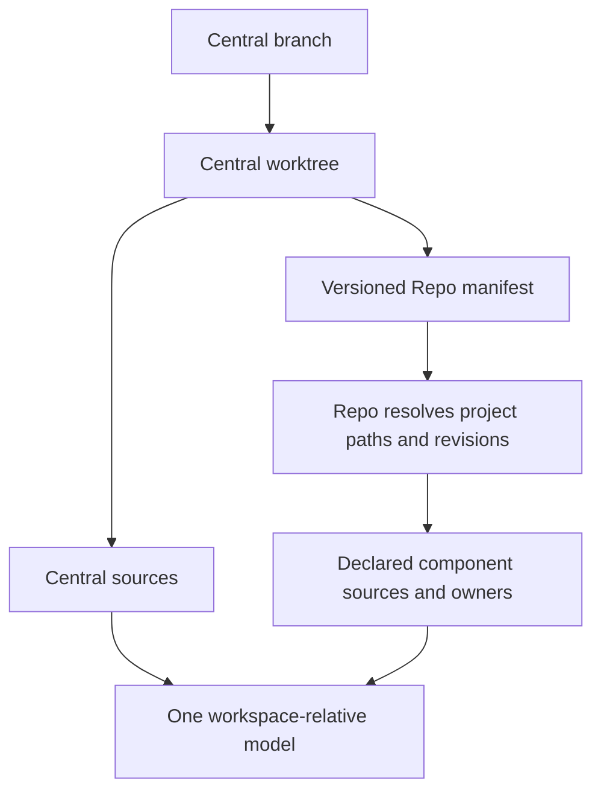

# Elements

### Manifest-Defined Workspace Scope

When a workspace is selected through a Repo manifest, the system SHALL resolve Central and its declared component repositories as one workspace-relative model scope, with each source retaining its owning repository and selected revision. It SHALL reject invalid or unavailable selections before accepting the model and preserve ordinary single-repository scope behavior.

#### Concept References
  * [Repo Workspace](../Thesaurus/Thesaurus.md#repo-workspace)
  * [Repo Manifest](../Thesaurus/Thesaurus.md#repo-manifest)

#### Metadata
  * type: requirement

#### Relations
  * derivedFrom: [Workspace Root Path Authority](ModelManagement.md#workspace-root-path-authority)
  * satisfiedBy: [config.rs](../../crates/reqvire-core/src/config.rs)
  * satisfiedBy: [repo_workspace.rs](../../crates/reqvire-core/src/repo_workspace.rs)
  * satisfiedBy: [workspace.rs](../../crates/reqvire-core/src/workspace.rs)
---

### Reproducible Workspace Composition

WHEN a manifest-defined composition is checkpointed or reconstructed, the system SHALL associate the workspace-root revision with the exact versioned manifest-owner inputs and component commits, preserving native Repo selection and actual Git ownership without requiring a duplicate root manifest or a second baseline selector.

#### Metadata
  * type: requirement
  * owner: syseng
  * priority: high
  * risk: high
  * status: approved

#### Relations
  * derivedFrom: [Manifest-Defined Workspace Scope](#manifest-defined-workspace-scope)
  * satisfiedBy: [mcp_repo.rs](../../crates/reqvire-cli/src/mcp_repo.rs)
  * satisfiedBy: [git_commands.rs](../../crates/reqvire-core/src/git_commands.rs)
  * satisfiedBy: [repo_composition.rs](../../crates/reqvire-core/src/repo_composition.rs)
  * satisfiedBy: [repo_impact.rs](../../crates/reqvire-core/src/repo_impact.rs)
---

### Manifest-Defined Workspace Scope Specification

The owning Central Git worktree remains the effective workspace and identifier root. Repo's .repo/manifest.xml is the default manifest location. --manifest overrides that file location; both selections use the same Repo manifest format and preserve the inputs' Git ownership and history. No duplicate manifest is required in Central. Repo resolves the selected composition; scope includes Central itself and the declared projects. An alternate selected file must not be silently replaced by Repo's separate cached copy.

Require Git, Python 3 and initialized local Google Repo metadata at the workspace root. The caller explicitly initializes and synchronizes the client before admission. Keep Repo administration and component checkouts out of Central's tracked files. Capture the selected manifest inputs, whether under Repo administration or at an alternate workspace location. Support includes, extend-project composition, local overlays for Repo-managed selections, relative fetch URLs, remote aliases and remote-level revision precedence; reject submanifests. A checkout may name its remote differently when one repository identity matches unambiguously, including equivalent SSH URL spellings. Reject conflicting remote identities.

Resolve project revision names to concrete available local commits and retain the selected manifest inputs and per-project revision provenance with the loaded model. Project files remain Central-relative identifiers. Repository identity is ownership/provenance metadata, not an element namespace. Capture tracked inputs separately from Central and each declared repository so that Central ignoring the component checkout directory does not hide declared project sources. Workspace .reqvireignore exclusions remain global; a repository's Git ignores apply within its own ownership boundary. Exclude Repo metadata, copied dependency/build models and undeclared component repositories from this mode.

Require unique, non-overlapping project checkout paths, matching local Git project identity, available revisions and containment within the effective workspace. Reject unavailable projects/commits, duplicate project paths, path traversal, symlink escapes and foreign checkouts with the affected manifest/project/path. Do not silently fall back to ordinary Git scope after a selected manifest fails. Manifest-defined source discovery is common to CLI, MCP and Explorer; their existing admission and freshness policies remain interface-owned.

The source boundary supplies the declared project inventory, selected revisions and file-to-repository ownership to consumers. Worktree creation, private-checkout lifecycle, accepted-session mutation, Git commit sequencing and Explorer publication are owned by their respective interface requirements, rather than by source discovery.

Within each relation-validation pass, resolve the effective workspace scope at most once when file targets require it, and reuse that inventory and selected revision provenance for every file-reference check, including a failed scope resolution. Increasing the number of file references must not repeat Repo manifest resolution or project Git verification. Each new pass observes the current workspace selection through the existing admission boundary; accepted MCP snapshots retain their own request-local scope. Preserve per-reference existence, ownership and eligibility diagnostics.

Repo-managed manifest files own the dependency pins at their selected location. Updating pins preserves their include and local-overlay composition and must not create a duplicate Central manifest or add Repo administration to Central's Git tree. Manifest inputs retain their actual Git ownership. Explicit MCP composition commits checkpoint accepted pin updates in those owners and record their revision association in the workspace-root history; ordinary discovery does not create commits. Manifest files belonging to the workspace-root Git worktree retain its ordinary Git checkpoint behavior; the flag does not introduce another manifest type.

#### Metadata
  * type: specification

#### Relations
  * define: [Manifest-Defined Workspace Scope](#manifest-defined-workspace-scope)
---

### Workspace Composition Checkpoint Specification

#### Details
- Native selection remains .repo/manifest.xml. Resolve the actual selected source, includes, overlays, and their Git owners. --manifest remains an optional alternate selection, not a workaround for historical impact.
- Version .reqvire-composition.json in the workspace-root repository when native manifest history needs an explicit association. Its containing root commit identifies the root revision; do not encode that commit in its own tree or copy XML into the record.
- Schema version 1 contains schema_version: 1, selection (workspace-relative entry), manifest (actual selected source), and sources sorted by path. Each source contains path (workspace-relative source), owner (workspace-relative owning checkout; empty for root), source (owner-relative tracked path), repository (configured owning remote identity), and commit (exact full owner commit for non-root owners; omitted for root-owned sources).
- Validate unique normalized contained paths, complete source inventory, known schema, owner identity, tracked source membership, and locally available exact commits. Root-owned sources come from the containing root tree. Generated Repo entry wrappers/configuration are reconstructed administration, not independent versioned XML sources.
- Capture native include/overlay sources in their actual owners. A required unversioned overlay blocks reproducible checkpointing/history with its exact path. Ordinary current inspection retains existing source-loading behavior.
- Prefer a committed record when present; never substitute live source bytes for its revisions. A legacy root-owned manifest can be read directly from the selected root tree. A native input may be resolved from the same root Git history only when identity and owner-relative historical paths establish that association unambiguously; otherwise report unavailable historical association.
- At an explicit current HEAD baseline, captured committed owner revisions may identify the current committed composition. This does not permit guessing another root commit's manifest selection.
- An explicit commit can initialize a missing root association or pin an admitted mutable selection even with no pending model edits. This is a meaningful composition checkpoint; a fully recorded unchanged composition returns no-op.
- Commit changed component branches first, then selected manifest-owner changes, then the root association and accepted root changes. A component-only checkpoint has a meaningful root association change. Do not add .repo administration or component checkout files to the root tree.
- Treat multiple checkouts of the same Git history as related ownership, not automatically as the same branch. Do not create circular self-pins. A distinct native manifest checkout sharing root repository identity uses a separate manifest lane, reqvire/manifests/<root-branch>, during branch preparation. Reject competing owner checkouts targeting one logical repository branch before checkpoint or publication side effects; repeated source files of one owner are one participant. Publish required independent owner branches before the root.
- Missing objects, invalid records, dirty manifest inputs, identity conflicts, or partial checkpoints fail explicitly without fetching, syncing, resetting external work, or reporting on-disk pin bytes alone as committed acceptance.

#### Metadata
  * type: specification

#### Relations
  * define: [Reproducible Workspace Composition](#reproducible-workspace-composition)
---
