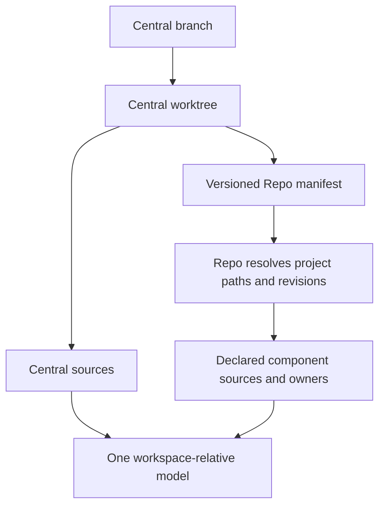

# Elements

### Manifest-Defined Workspace Scope

When a workspace is selected through a Repo manifest, the system SHALL resolve Central and its declared component repositories as one workspace-relative model scope, with each source retaining its owning repository and selected revision. It SHALL reject invalid or unavailable selections before accepting the model and preserve ordinary single-repository scope behavior.

#### Concept References
  * [Repo Workspace](../Thesaurus/Thesaurus.md#repo-workspace)
  * [Repo Manifest](../Thesaurus/Thesaurus.md#repo-manifest)

#### Metadata
  * type: requirement

#### Relations
  * derivedFrom: [Workspace Root Path Authority](ModelManagement.md#workspace-root-path-authority)
---

### Manifest-Defined Workspace Scope Specification

The owning Central Git worktree remains the effective workspace and identifier root. Its versioned Repo manifest selects declared project paths and revisions. Repo resolves the effective manifest, including supported composition; source scope includes Central itself and the resolved declared projects. A different manifest checkout or remote manifest branch cannot silently replace the selected Central worktree's versioned selection.

Resolve project revision names to concrete available local commits and retain the selected manifest inputs and per-project revision provenance with the loaded model. Project files remain Central-relative identifiers. Repository identity is ownership/provenance metadata, not an element namespace. Capture tracked inputs separately from Central and each declared repository so that Central ignoring the component checkout directory does not hide declared project sources. Workspace .reqvireignore exclusions remain global; a repository's Git ignores apply within its own ownership boundary. Exclude Repo metadata, copied dependency/build models and undeclared component repositories from this mode.

Require unique, non-overlapping project checkout paths, matching local Git project identity, available revisions and containment within the effective workspace. Reject unavailable projects/commits, duplicate project paths, path traversal, symlink escapes and foreign checkouts with the affected manifest/project/path. Do not silently fall back to ordinary Git scope after a selected manifest fails. Manifest-defined source discovery is common to CLI, MCP and Explorer; their existing admission and freshness policies remain interface-owned.

The source boundary supplies the declared project inventory, selected revisions and file-to-repository ownership to consumers. Worktree creation, private-checkout lifecycle, accepted-session mutation, Git commit sequencing and Explorer publication are owned by their respective interface requirements, rather than by source discovery.

#### Metadata
  * type: specification

#### Relations
  * define: [Manifest-Defined Workspace Scope](#manifest-defined-workspace-scope)
---
